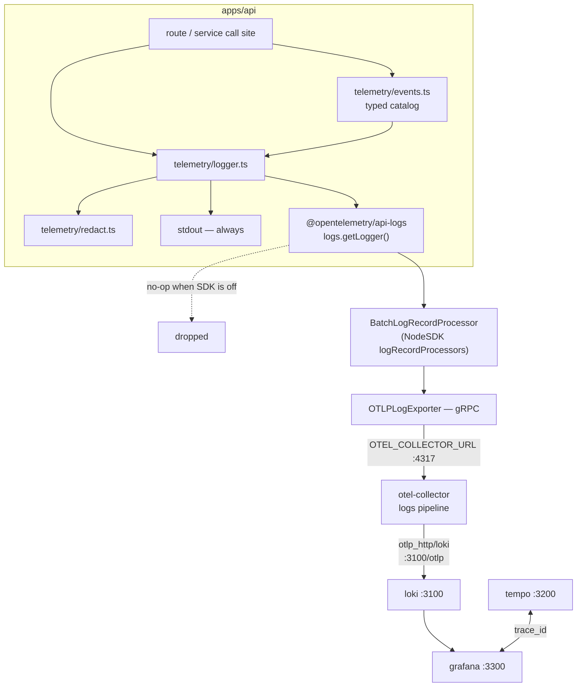

# Observability — Logs Design

**Spec**: `.specs/features/observability-logs/spec.md`
**Context**: `.specs/features/observability-logs/context.md`
**Status**: Draft

---

## Research findings

Verified before designing, in the order the knowledge chain prescribes. Two of these
contradict what `docs/observability.md` § "Adding Loki next" assumed, so they are recorded
with how they were checked.

| # | Finding | How it was verified |
| --- | --- | --- |
| F1 | **The Collector has no `loki` exporter.** `otel/opentelemetry-collector-contrib:0.160.0` ships `loki` only as a *receiver*. Logs must go to Loki's native OTLP endpoint instead | `docker run --rm --entrypoint /otelcol-contrib otel/opentelemetry-collector-contrib:0.160.0 components` on the pinned image |
| F2 | The OTLP exporters in this build are named `otlp_grpc` / `otlp_http`, not `otlp` / `otlphttp` | Same listing; matches the existing `otlp_grpc/tempo` in the Collector config |
| F3 | `NodeSDK` 0.222.0 accepts `logRecordProcessors: LogRecordProcessor[]`, builds a `LoggerProvider` from it, calls `logs.setGlobalLoggerProvider`, and includes the provider in `shutdown()` | `node_modules/.pnpm/@opentelemetry+sdk-node@0.222.0/.../build/src/types.d.ts` and `sdk.js` |
| F4 | `Logger.emit()` falls back to `context.active()` when the record carries no context, so `trace_id`/`span_id` correlation is automatic | opentelemetry-js `sdk-logs/src/Logger.ts`, via Context7 |
| F5 | The OTel logs `LogRecord` has a first-class `eventName` field, separate from `attributes` | opentelemetry-js `api-logs/src/types/LogRecord.ts`, via Context7 |
| F6 | Loki promotes only resource attributes to index labels, defaulting to `service.name`, `service.namespace`, `service.instance.id`, `deployment.environment(.name)` + cloud/k8s keys. Everything else lands as structured metadata. The `index_label` action exists for resource attributes only | Loki `distributor.otlp_config` reference, via Context7 |
| F7 | OTLP ingestion **requires** `limits_config.allow_structured_metadata: true` | Loki structured-metadata docs, via Context7 |
| F8 | `grafana/loki:3.7.2` is the newest published tag; there is no 3.8 or 4.x | `docker manifest inspect` across candidate tags |

**F1 is the important one.** It means the four-step plan in `docs/observability.md` is wrong at
step 2 — there is no `loki` exporter to add. That doc gets corrected as part of LOG-19.

**F6 is the second.** It retires the idea of `event.domain` as a Loki label: it is a per-record
attribute, and Loki cannot index those. It becomes structured metadata, which Loki 3.x filters
efficiently — `{service_name="tatame-api"} | event_domain="checkin"`. LOG-07 was reworded to
match. This is a better outcome anyway: a label would have multiplied the stream count by the
number of domains for no query benefit.

---

## What the previous attempt got wrong

There *was* a logger here. `apps/api/src/lib/logger.ts` — pino, with
`pino-opentelemetry-transport` alongside a `pino-pretty` target — removed in `62b4051`
("remove entire observability stack", 2026-09-07) along with 46 call sites across 12 files.
The commit message lists why the stack was unusable, and two of those reasons are about logs
specifically:

> the Loki derived field matched a trace_id pattern OTLP logs never emit, and logs were
> exported through two competing paths

Both trace back to one root cause: **pino transports run in a worker thread.** A worker cannot
see the main thread's active span context, so `pino-opentelemetry-transport` had to stand up its
own `LoggerProvider` with its own resource attributes:

```javascript
// the removed logger.ts — a second provider, hardcoded resource, no namespace
resourceAttributes: {
  "service.name": "tatame-api",
  "deployment.environment": env.NODE_ENV,   // note: not deployment.environment.name
}
```

That is the "two competing paths": the SDK's provider in the main thread and the transport's in
a worker, disagreeing about the resource. It is also why no log ever carried a usable `trace_id`
— the worker had no span context to read — which in turn is why the Loki derived field never
matched anything.

Three consequences for this design, each already baked in above:

1. **One provider, owned by `NodeSDK`.** `logger.ts` consumes the *global* provider through
   `@opentelemetry/api-logs` and never constructs one. This is the real argument for the thin
   module over pino, and it is stronger than the dependency-count argument in the decisions
   table: pino's transport architecture is structurally incompatible with in-process trace
   correlation.
2. **Emission stays on the main thread**, which is what makes F4 (`context.active()`) work at
   all. LOG-03 depends on this and on nothing else.
3. **The derived field is a known hazard, not an open question.** Open question 1 above is the
   exact bug this repo already shipped once. Matching a regex against the log line cannot work:
   OTLP carries `trace_id` as a record field, which Loki stores as structured metadata, never in
   the body. The task that writes the datasource verifies the link end to end against a real
   record before it is called done — the previous attempt's failure mode was precisely that
   nobody clicked the link.

One leftover from that removal is still in the tree: `apps/api/vitest.config.ts` excludes
`src/lib/logger.ts` from coverage, a file that no longer exists. The new logger lives at
`src/telemetry/logger.ts` and *is* unit-tested, so that stale exclude is deleted rather than
repointed.

---

## Architecture Overview



The application side is one dependency deeper than metrics and traces, because logs need an
emitter the app calls by hand. Everything past `logs.getLogger()` is the same shape as the other
two signals: the app knows the Collector, and nothing else.

**The decoupling that makes this safe:** `logger.ts` never imports the SDK. It asks
`@opentelemetry/api-logs` for the global logger, which `instrumentation.ts` may or may not have
registered. When telemetry is off the API hands back a no-op logger and the only cost is a
function call — so `logger.ts` is an ordinary module that any file can import, with none of the
load-order constraints `error-capture.ts` lives under.

---

## Code Reuse Analysis

### Existing components to leverage

| Component | Location | How to use |
| --- | --- | --- |
| Redaction (`isSensitive`, `segments`, `redact`, `MAX_DEPTH`) | `apps/api/src/telemetry/error-capture.ts` | **Extract** to `telemetry/redact.ts`, import from both. One list, one behaviour, one test — satisfies LOG-15 without a second word list drifting from the first |
| `error-capture.test.ts` redaction cases | `apps/api/src/telemetry/error-capture.test.ts` | Move the redaction half to `redact.test.ts`. The `apiKey`-redacted / `monkey`-not pair is the regression that list already broke once |
| SDK bootstrap, opt-in gates, `flushTelemetry()` | `apps/api/src/instrumentation.ts` | Extend, do not fork. `OTEL_LOGS_ENABLED` mirrors `OTEL_TRACES_ENABLED` exactly; F3 means shutdown already flushes logs (LOG-11 is free) |
| `HttpError` + `details.code` | `apps/api/src/lib/http-error.ts` | The error codes it already carries are the natural source of `event.reason` for rejections |
| Collector exporter naming (`otlp_grpc/tempo`) | `infra/observability/otel-collector-config.yml` | Add `otlp_http/loki` in the same style, plus a third pipeline |
| Datasource provisioning with fixed `uid` | `infra/observability/grafana/provisioning/datasources/datasources.yml` | Add `uid: loki`; the APM dashboard's `loki_datasource` variable resolves by type, so no dashboard JSON changes |
| `section(..., { collapsed })` helper | `scripts/build-apm-dashboard.mjs:260` | Flip the `Logs` row to expanded; the `visibleLoki` guard at :320 was written for the Loki-less state and inverts |
| `[prefix]` log convention | 69 call sites | The prefix becomes a structured field, the prose stays the message |

### Integration points

| System | Integration |
| --- | --- |
| Tempo | Grafana `tracesToLogsV2` on the Tempo datasource; `derivedFields` on the Loki datasource. Both directions, LOG-08 |
| Prometheus | None. Events are logs; no metric is derived from them in this iteration |
| Existing span error capture | Untouched. `app.error.body` answers "what did this request return"; `request.failed` answers "what broke". They share a `trace_id` and nothing else |

---

## Components

### 1. `redact.ts` (extracted)

- **Purpose**: Shared redaction and safe serialization for anything leaving the process as telemetry.
- **Location**: `apps/api/src/telemetry/redact.ts`
- **Interfaces**:
  - `isSensitive(key: string): boolean`
  - `redact(value: unknown, depth?: number): unknown`
  - `serialize(body: unknown, maxChars?: number): string`
- **Dependencies**: **none, deliberately.** This module must stay import-free so `error-capture.ts`
  can take a runtime dependency on it without violating its own "no runtime imports" rule — that
  rule exists because `instrumentation.ts` loads it before Express, and a value import there
  could pull an instrumented library in early.
- **Reuses**: verbatim move from `error-capture.ts`.

### 2. `logger.ts`

- **Purpose**: The one way anything in `apps/api` writes a log.
- **Location**: `apps/api/src/telemetry/logger.ts`
- **Interfaces**:
  ```typescript
  type Level = "debug" | "info" | "warn" | "error"

  interface LogFields { [key: string]: unknown }

  export const log: {
    debug(message: string, fields?: LogFields): void
    info(message: string, fields?: LogFields): void
    warn(message: string, fields?: LogFields): void
    /** `fields.err` becomes exception.type / .message / .stacktrace */
    error(message: string, fields?: LogFields & { err?: unknown }): void
    /** Binds fields onto every record from the returned logger. */
    child(fields: LogFields): typeof log
  }
  ```
- **Behaviour**:
  - Writes to stdout **unconditionally** (LOG-09), one JSON object per line outside a TTY, and a
    short human line when `process.stdout.isTTY` — the terminal stays readable in `pnpm api:dev`.
  - Emits to `logs.getLogger("tatame-api")` on every call. No-op when the SDK is off (F3/F4).
  - Silent under `NODE_ENV=test` unless `LOG_LEVEL` is set, so `vitest` output stays legible.
  - Every public method wraps its whole body in `try {} catch {}` (LOG-10). A logger that throws
    would turn a working request into a 500 — the one failure mode that must not exist.
  - `fields` is redacted and depth-capped through `redact.ts` before either sink.
- **Dependencies**: `@opentelemetry/api-logs`, `redact.ts`.
- **Reuses**: redaction; the `[prefix]`-plus-context shape already used at the call sites.

### 3. `events.ts` — the typed catalog

- **Purpose**: Make `event.name` and `event.reason` closed sets that the compiler enforces (LOG-12).
- **Location**: `apps/api/src/telemetry/events.ts`
- **Interfaces**:
  ```typescript
  const CATALOG = {
    "checkin.created":  { domain: "checkin", outcome: "success" },
    "checkin.rejected": {
      domain: "checkin",
      outcome: "rejected",
      reasons: [
        "NOT_A_STUDENT", "NO_ACTIVE_MEMBERSHIP", "CLASS_NOT_FOUND", "WINDOW_CLOSED",
        "CLASS_FULL", "WEEKLY_LIMIT_REACHED", "DUPLICATE", "LOCK_BUSY",
      ],
    },
    // ... one entry per event in the spec's catalog table
  } as const satisfies Record<string, EventDefinition>

  export type EventName = keyof typeof CATALOG

  /** The reasons this event declares — `never` for events that declare none. */
  type ReasonOf<N extends EventName> =
    (typeof CATALOG)[N] extends { reasons: readonly (infer R)[] } ? R : never

  export function emitEvent<N extends EventName>(
    name: N,
    fields: EventFields &
      ([ReasonOf<N>] extends [never] ? { reason?: never } : { reason: ReasonOf<N> }),
  ): void
  ```
  The conditional on `ReasonOf<N>` is the whole point: `reason` is **required** on
  `checkin.rejected`, **forbidden** on `checkin.created`, and only accepts the eight strings that
  event declares. A typo does not compile, which is what LOG-12 asks for.
- **`EventFields`** — a closed record of the identifiers the domains actually carry, so attribute
  names cannot drift between call sites:
  ```typescript
  interface EventFields {
    userId?: string; actorRole?: Role; academyId?: string
    classId?: string; checkinId?: string; membershipId?: string; dependentId?: string
    subscriptionId?: string; paymentId?: string; graduationId?: string
    announcementId?: string; clerkUserId?: string; stripeSubscriptionId?: string
    /** Anything domain-specific and non-identifying. Redacted like everything else. */
    extra?: Record<string, unknown>
    /** Only meaningful when the catalog entry's outcome is "failed". */
    err?: unknown
  }
  ```
  There is no index signature on purpose — `extra` is the escape hatch, and it is visibly one.
- **Dependencies**: `logger.ts`, `@tatame/types` (for `Role`).

### 4. `instrumentation.ts` (extended)

Add, inside the existing `else` branch that already gates on `OTEL_COLLECTOR_URL` and `NODE_ENV`:

```typescript
const logsEnabled = process.env.OTEL_LOGS_ENABLED !== "false"
// ...
...(logsEnabled
  ? { logRecordProcessors: [
        // 0.222.0 takes an options object here, not a bare exporter.
        new BatchLogRecordProcessor({ exporter: new OTLPLogExporter({ url: collectorUrl }) }),
      ] }
  : {}),
```

~~Unlike traces, the disabled case needs no `logRecordProcessors: []` counterpart.~~ **Wrong —
corrected at T7 by a boot smoke test.** The SDK has the same env fallback for logs that it has for
traces: `configureLoggerProviderFromEnv` treats an empty `OTEL_LOGS_EXPORTER` as `otlp`, defaulting
to `http/protobuf`, so omitting the key would ship logs to `localhost:4318` — the Collector's HTTP
port in this very stack. `OTEL_LOGS_ENABLED=false` would have kept exporting, over a different
protocol. The disabled branch passes `logRecordProcessors: []`, which is truthy and therefore
suppresses the fallback (`if (!this._loggerProviderConfig)` in `sdk.js`).

New dependencies: `@opentelemetry/sdk-logs`, `@opentelemetry/exporter-logs-otlp-grpc`,
`@opentelemetry/api-logs` — all already in the lockfile at `0.222.0` as transitive deps, so this
is a `package.json` promotion, not a new resolution.

### 5. Infrastructure

| File | Change |
| --- | --- |
| `infra/observability/loki.yml` | **New.** Single-binary, `auth_enabled: false`, filesystem storage, TSDB schema `v13`, `allow_structured_metadata: true` (F7), `compactor.retention_enabled: true` with `retention_period: 168h` to match Prometheus and Tempo |
| `docker-compose.observability.yml` | **New service** `loki` on `grafana/loki:3.7.2` (F8), publishing `3100`, named volume `tatame_loki_data`. `otel-collector` gains `depends_on: loki`; `grafana` too |
| `infra/observability/otel-collector-config.yml` | New exporter `otlp_http/loki` → `endpoint: http://loki:3100/otlp` (F1, F2), `tls.insecure: true` like the Tempo one. New `logs` pipeline: `receivers: [otlp]`, `processors: [memory_limiter, batch]`, `exporters: [otlp_http/loki, debug]` |
| `.../datasources/datasources.yml` | New `Loki` datasource, `uid: loki`. `derivedFields` on `trace_id` → the `tempo` datasource (logs → trace). Tempo datasource gains `tracesToLogsV2` → `loki` (trace → logs). LOG-08 |
| `scripts/build-apm-dashboard.mjs` | `section("Logs", [], { collapsed: true })` → `collapsed: false`; the `visibleLoki` guard at :320 inverts from "must be hidden" to "must be present" |
| `packages/config/src/env.ts` | `OTEL_LOGS_ENABLED` and `LOG_LEVEL`, both optional — matching how `OTEL_TRACES_ENABLED` is read straight from `process.env` in `instrumentation.ts`, the schema entry is documentation for `.env.example` |
| `apps/api/eslint.config.js` | `"no-console": "error"` for `**/*.ts`, disabled for `**/*.test.ts`, `src/seed.ts`, `src/instrumentation.ts` (LOG-17) |

---

## Data model — the log record

| Field | Where it lands in OTLP | In Loki |
| --- | --- | --- |
| `service.name`, `service.namespace`, `service.instance.id`, `deployment.environment.name` | Resource | **Index labels** — free, Loki's defaults (F6) |
| message | `body` | The log line |
| level | `severityText` + `severityNumber` | `detected_level` |
| `event.name` | `eventName` **and** an attribute | Structured metadata |
| `event.domain`, `event.outcome`, `event.reason` | Attributes | Structured metadata |
| `user.id`, `app.actor.role`, `app.academy.id`, `app.class.id`, … | Attributes | Structured metadata |
| `exception.type`, `exception.message`, `exception.stacktrace` | Attributes | Structured metadata |
| `trace_id`, `span_id` | From the active context (F4) | Structured metadata |

`event.name` is written **twice** — into the native `eventName` field (F5) and as an attribute.
The native field is the semantically correct home, but whether Loki's OTLP handler persists it is
not something this design verified; the duplicate attribute costs a few bytes and guarantees the
field is queryable. The implementation task checks the native field in Grafana and drops the
duplicate if it survives the trip.

**Severity mapping**: `debug` → 5, `info` → 9, `warn` → 13, `error` → 17.

---

## Error Handling Strategy

| Scenario | Handling | Impact |
| --- | --- | --- |
| Collector down at boot | `BatchLogRecordProcessor` queues and retries in the background | None. Records drop once the 2048-record queue fills |
| Loki down, Collector up | Collector's own retry/queue; drops after that | None on the API |
| Log emitted outside a span | Exported with no `trace_id` (F4 falls back to an empty active context) | Boot and worker logs still reach Loki |
| `fields` cyclic or unserializable | Depth cap in `redact.ts`, `serialize` returns `"[unserializable]"` | Message and level survive |
| Logger itself throws | Caught and swallowed inside every public method | **The request is unaffected.** This is LOG-10 and it is the non-negotiable one |
| Shutdown mid-batch | `flushTelemetry()` → `sdk.shutdown()` already awaits the logger provider (F3) | Last batch is not lost |

---

## Tech Decisions

| Decision | Choice | Rationale |
| --- | --- | --- |
| Path into Loki | `otlp_http/loki` → Loki's native `/otlp` | The `loki` exporter does not exist in 0.160.0 (F1). Not a preference — the alternative is unavailable |
| Logger implementation | Thin module over `@opentelemetry/api-logs` | pino + `instrumentation-pino` would add a dependency, a second config surface and an ESM-hook `include` entry, to produce records this writes directly. The typed event catalog is the part with real value, and pino does not help with it |
| `event.domain` as label | No — structured metadata | Loki only indexes resource attributes (F6). Also the right answer on cardinality |
| stdout always on | Yes | "Migrate every `console.*`" plus "export-only" would mean a dev with no stack running loses all output. Export is additive |
| `reason` typing | Conditional type per event | The alternative — one flat union of every reason — would let `checkin.created` carry `PLAN_REQUIRED`. Compile-time is the only place this stays honest |
| `no-console` exceptions | `instrumentation.ts`, `seed.ts`, tests | The first cannot import the logger without breaking load order; the second is a CLI whose output is the product |
| Workers | Structured logs, no catalog events | Scope decision from `context.md`. They reach Loki via LOG-18 either way |
| Loki retention | 168h | Matches Prometheus and Tempo. Explicitly not an audit trail — that is out of scope |

---

## Open questions for implementation

Flagged rather than guessed, per the knowledge chain. Each is a gate check on its task, not a
blocker for the design.

1. **Grafana `derivedFields` against structured metadata.** Linking logs → trace needs the derived
   field to match a structured-metadata key rather than a regex over the log line. Grafana supports
   `matcherType: "label"` for this; the exact spelling in provisioning YAML is verified when the
   datasource is written, not assumed here.
2. **Whether Loki persists OTLP `eventName`.** Hence the belt-and-braces attribute above.
3. **`detected_level`** may need `discover_log_levels` enabled depending on the Loki build. Checked
   against a running instance; falls back to filtering on the severity attribute.
