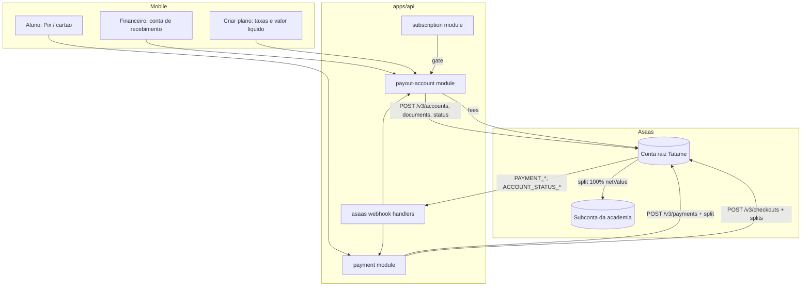
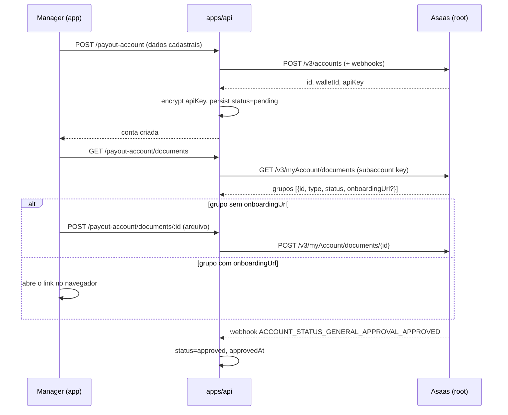
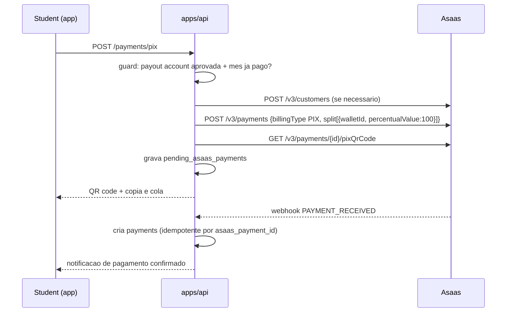

# Design — Asaas Payment Split

## Decision summary

| Decision | Choice | Why |
| --- | --- | --- |
| Provider | Asaas for student payments; Stripe stays for manager billing | One rail for Pix + card with native split, instead of AbacatePay for Pix and Stripe for card |
| Account model | One Asaas **subaccount per academy**, created from the Tatame root account | `walletId` is what the split needs, and it only exists for Asaas accounts |
| Split rule | `percentualValue: 100` to the academy wallet | Asaas splits over `netValue`, so 100% means "academy receives net, Tatame nets zero" (D1/D3) |
| Charge owner | The charge is created in the **root** account | The split moves money out; the fee applied is the root account's, which is also the rate shown on the plan screen |
| Fee source | `GET /v3/myAccount/fees` on the root key, cached | Rates change and must never be hardcoded |
| Source of truth for payments | Asaas webhooks only | Same rule already enforced for AbacatePay and Stripe |

## Architecture



## Data model

New enum and table in `packages/db/src/schema/index.ts`, plus two nullable columns.

```ts
export const payoutAccountStatusEnum = pgEnum("payout_account_status", [
  "pending",            // created, nothing reviewed yet
  "awaiting_documents", // Asaas is waiting on files
  "under_review",       // files sent, Asaas reviewing
  "approved",           // general === APPROVED — can receive split
  "rejected",           // needs correction
  "suspended",          // was approved, Asaas blocked it afterwards
]);

export const academyPayoutAccounts = pgTable("academy_payout_accounts", {
  id: uuid("id").primaryKey().defaultRandom(),
  academyId: uuid("academy_id").notNull().unique()
    .references(() => academies.id, { onDelete: "cascade" }),
  provider: text("provider").notNull().default("asaas"),
  externalAccountId: text("external_account_id").notNull(),
  walletId: text("wallet_id").notNull(),
  apiKeyEncrypted: text("api_key_encrypted").notNull(),
  status: payoutAccountStatusEnum("status").notNull(),
  generalStatus: text("general_status"),
  commercialInfoStatus: text("commercial_info_status"),
  documentStatus: text("document_status"),
  bankAccountInfoStatus: text("bank_account_info_status"),
  onboardingUrl: text("onboarding_url"),
  rejectionReason: text("rejection_reason"),
  approvedAt: timestamp("approved_at", { withTimezone: true }),
  createdAt: ..., updatedAt: ...,
});
```

Column additions:

- `users.asaas_customer_id text` — the Asaas customer reused across charges (SPLIT-01)
- `payments.asaas_payment_id text` — reconciliation key, alongside the existing `stripe_payment_id`

Replacement for `pending_pix_payments`: a provider-neutral `pending_asaas_payments`
keyed by the Asaas payment id, holding subscription, user, academy, reference month and
amount — exactly the role `pending_pix_payments` plays today for AbacatePay. The old
table stays until in-flight AbacatePay charges drain.

### Why the subaccount API key is stored

`GET /v3/myAccount/documents`, `POST /v3/myAccount/documents/{id}` and
`GET /v3/myAccount/status` are called **as the subaccount**, so its key is required.
It is returned once, at creation, and cannot be recovered later — losing it means the
academy can never finish onboarding from the app.

It is encrypted with AES-256-GCM using a new `PAYOUT_ACCOUNT_ENCRYPTION_KEY`, in a
small `apps/api/src/lib/crypto.ts`. The plaintext key never leaves the API and is never
logged or returned by any endpoint.

## Modules

```
apps/api/src/lib/asaas.ts                     # HTTP client (root key + per-subaccount key)
apps/api/src/lib/crypto.ts                    # encrypt/decrypt for the stored API key
apps/api/src/modules/payout-account/
  payout-account.repository.ts                # interface
  payout-account.repository.postgres.ts
  payout-account.repository.in-memory.ts
  payout-account.service.ts                   # create, documents, status, fees
  payout-account.routes.ts
  asaas-account-webhook.handler.ts            # ACCOUNT_STATUS_*
apps/api/src/modules/payment/
  asaas-payment.handler.ts                    # PAYMENT_*
```

This mirrors the repository-interface-plus-two-implementations pattern every module in
`apps/api/src/modules` already uses, so the service stays testable in memory.

## API surface

| Method | Path | Role | Requirement |
| --- | --- | --- | --- |
| `GET` | `/payout-account` | Manager | PAYOUT-05 |
| `POST` | `/payout-account` | Manager | PAYOUT-01, PAYOUT-02 |
| `GET` | `/payout-account/documents` | Manager | PAYOUT-03, PAYOUT-04 |
| `POST` | `/payout-account/documents/:groupId` | Manager | PAYOUT-03 |
| `GET` | `/payout-account/status` | Manager | PAYOUT-05 |
| `GET` | `/payout-account/fees` | Manager | PAYOUT-06 |
| `POST` | `/payments/pix` | Student, Guardian | SPLIT-02 |
| `POST` | `/payments/checkout` | Student, Guardian | SPLIT-03 |
| `POST` | `/webhooks/asaas` | public, token-guarded | SPLIT-04, PAYOUT-05 |

`POST /payments/checkout` keeps its path and its `{ checkoutUrl }` response shape, so
the mobile client changes provider without changing its contract. `POST /payments/pix`
replaces the AbacatePay endpoint and returns `{ paymentId, encodedImage, payload, expirationDate }`.

### Gating

`SubscriptionService.createPlan` and `SubscriptionService.selectPlan` both gain an
`assertAcademyCanReceive(academyId)` guard that throws
`HttpError(403, "...", { code: "PAYOUT_ACCOUNT_REQUIRED" })`. This follows the existing
`PLAN_LIMIT_PAYMENTS` convention, so `PlanLimitModal` on mobile already knows how to
render a coded 403.

`PaymentService.createPixCharge` and `createCheckout` call the same guard, closing the
hole where an old plan could still be paid into a void.

## Flows

### Onboarding



### Prefill and fallbacks

Every field is an **editable input with a default**, never a hidden value taken from
the database. The manager may have registered nothing, or may need the Asaas account to
carry data different from the academy's public contact.

| Asaas field | Prefill chain | When the chain is empty |
| --- | --- | --- |
| `name` | `academies.name` → `users.name` | never empty — `academies.name` is `NOT NULL` |
| `email` | `academies.contact_email` → `users.email` | never empty — `users.email` is `NOT NULL` |
| `mobilePhone` | `academies.contact_phone` → `users.phone` | empty, manager types it |
| `birthDate` (CPF) | `users.birth_date` | empty, manager types it |
| `cpfCnpj` | — | always typed; the platform stores no document today |
| `incomeValue` | — | always typed |
| address fields | — | filled from the `postalCode` lookup, not from `academies.address` |

`academies.address` is free text and cannot be split into `address` / `addressNumber` /
`province` / `postalCode` reliably, so it is not used. The CEP lookup fills the street,
neighborhood and city, and an invalid CEP is a 400 from Asaas — catching it client-side
avoids a round trip.

Form validation is independent of the prefill source: all nine Asaas-required fields are
required in the form even when the underlying column is nullable.

**No write-back.** Editing the e-mail here does not change `academies.contact_email` —
they serve different purposes. `contact_email` is what students see; the Asaas `email`
becomes the subaccount login (`loginEmail` defaults to it) and must be unique across
Asaas. An e-mail already tied to another Asaas account fails creation, which is exactly
why the field has to be editable and why the error has to come back readable (PAYOUT-01 AC4).

**Name vs. document.** Asaas validates `name` against the CPF/CNPJ at the Receita. An
academy whose trade name differs from its razão social will be rejected if the prefill is
submitted as-is, so the field carries helper text asking for the name as registered.

The docs require waiting at least 15 seconds after creation before the first
`GET /v3/myAccount/documents`, so the app fetches the document list on the screen that
follows creation, not inside the creation response.

### Student payment



Idempotency is a unique index on `payments.asaas_payment_id`, not an in-handler check —
Asaas delivers at least once, and `PAYMENT_CONFIRMED` followed by `PAYMENT_RECEIVED`
means two events for the same money.

## Fee disclosure

`GET /payout-account/fees` returns a normalized shape derived from
`GET /v3/myAccount/fees` on the root account:

```ts
{
  pix: { fixedFee: number, percentageFee: number, minFee: number, maxFee: number,
         monthlyFreeCredits: number, freeCreditsUsed: number },
  creditCard: { operationFee: number, percentage: number, daysToReceive: number },
  fetchedAt: string,
}
```

Cached for 12 hours (Redis when available, in-memory otherwise). On failure the
endpoint returns 503 and the plan screen degrades to "taxas indisponíveis no momento"
— never a stale or invented rate, per PAYOUT-06 AC4.

Net value shown on the plan screen:

```
pixNet  = price - clamp(pixFixedFee + price * pixPercentage, minFee, maxFee)
cardNet = price - (cardOperationFee + price * cardPercentage)
```

## Retiring the old rails

`SPLIT-06` removes the student-facing entry points — the AbacatePay Pix endpoint and
the Stripe Checkout session creation in `PaymentService` — while **keeping** both
webhook handlers until charges created before the cutover have drained. The handlers
are what record money already in flight; deleting them the same day would lose real
payments. `ABACATEPAY_API_KEY` stays configured until that drain is done.

Stripe itself stays: `manager-subscription` keeps using it untouched.

## Configuration

| Variable | Purpose |
| --- | --- |
| `ASAAS_API_KEY` | Root account key |
| `ASAAS_BASE_URL` | `https://api-sandbox.asaas.com` or `https://api.asaas.com` |
| `ASAAS_WEBHOOK_TOKEN` | Expected `asaas-access-token` header |
| `PAYOUT_ACCOUNT_ENCRYPTION_KEY` | AES-256-GCM key for the stored subaccount keys |

All optional in `packages/config/src/env.ts`, like the existing provider keys, so local
development without Asaas still boots.

## Risks

| Risk | Mitigation |
| --- | --- |
| The Tatame root account must be a CNPJ to create subaccounts | Confirm before starting; it blocks the whole feature |
| New subaccounts sit in a 60-day evaluation window with a cap of 10 subaccounts and R$ 2.000 per charge | Surface the Asaas error verbatim; plan the production rollout around the cap |
| Card money settles ~30 days out, unlike Pix | Show `daysToReceive` on the plan screen so the manager is not surprised |
| Chargeback reverses the split on the academy's side | `SPLIT-05` makes the event visible rather than silent |
| Losing the subaccount API key makes onboarding unrecoverable from the app | Persist it in the same transaction as the account row; fail the request if encryption fails |
