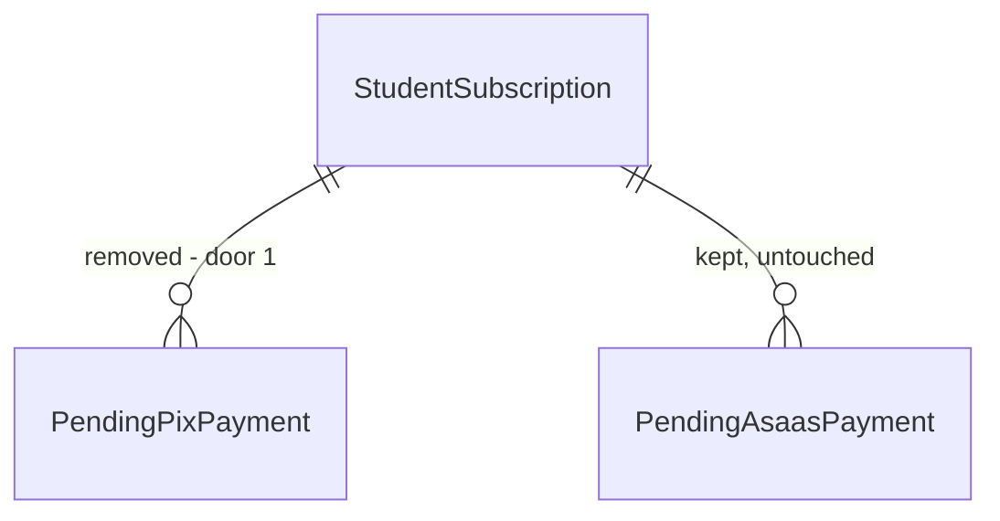

# Remove the AbacatePay Pix rail

## Problem

The API serves two student Pix rails and only one of them has a caller. `POST
/v1/payments/checkout/pix` and `GET /v1/payments/pix-status/:pixQrCodeId` are reached by no
client: `apps/mobile` is 2.1.3 on the stores, 2.1.3 calls only `POST /v1/payments/pix`, and
`MIN_MOBILE_VERSION` in production is 2.1.3, so the force-update screen stops every build that
called the old pair before it can reach a payment screen.

What the dead rail still costs. `payment.service.ts` holds two methods that open a Pix charge,
and which one is live is answerable only by reading a comment. `unpaidPixPerAcademy` sums two
tables into one number, and the dead half is wired into the same arithmetic as the live one —
the metric reporting zero while real unpaid charges pile up is a bug TAT-104 already had to fix
once in this exact function. A webhook route stays open for a provider that can no longer
produce a delivery, and the typed event catalogue accepts a drop reason (`NO_PENDING_PIX`) that
no code path can emit.

Evidence the source gives. TAT-187 names the two stages and their gates. TAT-104's
`tasks.md` records why the pair was restored after B9 deleted it: the API deploys at the moment
a build is submitted, Apple's reviewers exercise the app against it, and there is no
`expo-updates`, so both rails had to be live for one release. The maintainer ran the production
query on 2026-10-08: `pending_pix_payments` holds rows from three to five months ago and none
since — during a window when AbacatePay was the only student Pix rail, from 2026-04-09 until the
PR-27 deploy on 2026-10-07.

When this ships, one Pix rail exists in the code. No student, guardian or manager sees any
difference.

## Flow

Reuses nothing new — every path here already exists, and this change only removes hops from it.

1. `POST /v1/payments/pix` -> `PaymentService.createPixCharge` (exists) - opens the Asaas charge
   split whole into the academy wallet, persists `pendingAsaasPayments`; untouched
2. `POST /v1/webhooks/asaas` -> `AsaasPaymentWebhookHandler` (exists) - turns the settlement into
   a `payments` row and drops the pending row; untouched
3. removed hop: `POST /v1/payments/checkout/pix` -> `PaymentService.createPixQrCode` (exists) ->
   `pendingPixPayments` - no client reaches it
4. removed hop: `GET /v1/payments/pix-status/:pixQrCodeId` (exists) -> `api.abacatepay.com` - no
   client reaches it
5. removed hop: `POST /v1/webhooks/abacatepay` -> `AbacatePayWebhookHandler` (exists) ->
   `payments` - no delivery can arrive, because no QR code can be created
6. `send-daily-summary` -> `PostgresPlatformSummaryRepository.unpaidPixPerAcademy` (exists) -
   keeps reading `pendingAsaasPayments` with its `kind = 'payment'` filter, stops reading
   `pendingPixPayments`

## Impact

| Front | What changes |
| --- | --- |
| domain | retired term: `pendingPixPayments` / "the AbacatePay rail" - gone from the schema and the code; nothing branches on it after this change |
| domain | retired term: `NO_PENDING_PIX` meant "a paid Pix with no pending row, on the AbacatePay rail"; it leaves the `payment.webhook_unhandled` reason union - three readers, found while building and **corrected from this row's first version**, which claimed the rule only named it in prose: the `tatame-payment-unrecorded` **LogQL query** matches it in `event_reason=~"NO_PENDING_PIX\|NO_PENDING_CHARGE\|MISSING_REFERENCE"`, the rule's email description names it, and `docs/observability.md` gives it a table row. Dropping one alternative leaves the regex matching the two reasons the live rails emit, so the alert keeps firing |
| observability | `catalog-coverage.test.ts` asserts both directions already: every catalogue reason needs a call site in non-test source, and every money reason needs to appear in an `expr:` line of `rules.yml`. Removing the reason from the catalogue, the handler and the query together is what keeps both green - removing it from only one of the three is what this test exists to catch |
| stored data | nothing to migrate: `pending_pix_payments` is dropped with its production rows, which expired 30 minutes after creation (`expiresIn: 1800`), were never paid, and fall outside every window `unpaidPixPerAcademy` reads (one day) |
| config | `ABACATEPAY_API_KEY` leaves `envSchema`; the variable may stay set in the production environment and is ignored, because `envSchema` is a non-strict `z.object` and strips unknown keys |
| test harness | `TRUNCATE_ALL` and `seed.ts` both name `pending_pix_payments` and must stop: a truncate against a table the post-`0024` schema does not define raises, which fails every integration test and the seed |

## Relations

One-way constraints removed: the `pending_pix_payments` primary key and its three cascading
foreign keys to `student_subscriptions`, `users` and `academies` cease to exist (door 1). No
constraint is added. No columns and no types here.

## Surface

Only routes whose signature changes — all three change by ceasing to exist.

| Route | In | Out | Status |
| --- | --- | --- | --- |
| `POST /v1/payments/checkout/pix` | — (removed) | `{error}` | `404` |
| `GET /v1/payments/pix-status/:pixQrCodeId` | — (removed) | `{error}` | `404` |
| `POST /v1/webhooks/abacatepay` | — (removed) | `{error}` | `404` |

## Landing

| One-way door | Literal shape | Alternative rejected |
| --- | --- | --- |
| `pending_pix_payments` dropped with its rows | `DROP TABLE "pending_pix_payments" CASCADE;` as drizzle migration `0024`, no archive step | `CREATE TABLE pending_pix_payments_archive AS SELECT * FROM pending_pix_payments` before the drop - leaves a table no code reads and no report sums, and the next reader of the schema has to work out whether it is live |
| the three routes withdrawn from the `/v1` contract | the route handlers deleted; the paths answer Express's default `404` | answering `410 Gone` from a kept stub - a client able to receive the `410` is a client the force-update screen already stopped, so the status informs nobody and the stub has to be removed later anyway |
| `NO_PENDING_PIX` retired from the typed event catalogue | the string leaves the `reasons` array of `payment.webhook_unhandled` in `src/telemetry/events.ts` | keeping it so historical Loki queries stay typed - the catalogue types what the code **can emit**; a reason no path can reach makes the union lie about the system |

- Nothing else in this change is hard to reverse: the service method, the repository methods, the
  handler, the interface rows and the deleted tests all come back with a revert

## Criteria

### S1: The entry points are gone (P1)

No code path in the API can open an AbacatePay Pix charge or ask AbacatePay about one.

**Acceptance Criteria**

1. WHEN a client calls `POST /v1/payments/checkout/pix` THEN the API SHALL answer `404`
2. WHEN a client calls `GET /v1/payments/pix-status/:pixQrCodeId` THEN the API SHALL answer `404`
3. The system SHALL contain no code path under `apps/api/src` that requests `api.abacatepay.com`
4. WHEN a student calls `POST /v1/payments/pix` THEN the system SHALL open an Asaas Pix charge and
   persist exactly one `pending_asaas_payments` row for that subscription and month

**Independent test:** boot the app with Clerk unconfigured and confirm both removed paths answer
`404` where every live authorized route answers `503`; then run the Asaas Pix charge suite green.

### S2: The recording side and the table are gone (P1)

Nothing is left to receive an AbacatePay delivery, store a pending QR code, or report one.

**Acceptance Criteria**

5. WHEN a request arrives at `POST /v1/webhooks/abacatepay` THEN the API SHALL answer `404`
6. The system SHALL define no `pending_pix_payments` table after drizzle migration `0024` is
   applied
7. The system SHALL NOT accept `NO_PENDING_PIX` as a reason for `payment.webhook_unhandled`
8. WHILE no payment row carries its `asaas_payment_id`, `unpaidPixPerAcademy` SHALL report a `kind = 'payment'` row inside the day window with a count of `1` and its `amount_cents`
9. The system SHALL exclude every `pending_asaas_payments` row of `kind` `checkout` from
   `unpaidPixPerAcademy`
10. WHEN the integration harness truncates between tests THEN the truncate SHALL succeed against
    the schema migration `0024` produces
11. The system SHALL document no `payment.webhook_unhandled` reason that the event catalogue does
    not accept

**Independent test:** apply the migrations into a fresh schema, insert one unpaid `kind: 'payment'`
row and one `kind: 'checkout'` row for the same academy, and confirm `unpaidPixPerAcademy` reports
the first and not the second.

## Out of scope

| Excluded | Why |
| --- | --- |
| Bringing the student card rail back (`CARD_PAYMENT_ENABLED`) | TAT-189 replaces it with an Asaas `RECURRENT` subscription; flipping it now would ship the every-month-retype checkout this project already decided against |
| Deleting the AbacatePay webhook registration on AbacatePay's dashboard | outside the repository, and nothing depends on it: no QR code can be created, so no `billing.paid` can be produced |
| Closing the AbacatePay account or unsetting `ABACATEPAY_API_KEY` in production | an operational step with no code consequence - the key is read by nothing once the schema entry is gone |
| Rewriting `docs/superpowers/plans/2026-04-09-abacatepay-pix-checkout.md` and the TAT-104 spec set | those are a record of what was built and when, not live documentation; editing them would destroy the only account of why the rail existed |

## Assumptions

| Assumption | Chosen default | Rationale | Confirmed? |
| --- | --- | --- | --- |
| Whether stage 1's gate is met | both stages land in one branch | maintainer confirmed on 2026-10-08 that 2.1.3 is on the stores and `MIN_MOBILE_VERSION` in production is 2.1.3 | y |
| What happens to the production rows still in `pending_pix_payments` | dropped with the table, no archive and no dump | every row expired 30 minutes after creation, none was ever paid, and `unpaidPixPerAcademy` reads a one-day window, so no current report sums them | y |
| Stage 2's literal acceptance criterion (`count(*) = 0`) is not met | proceed anyway, and record why | the criterion is a proxy for "can a webhook still arrive for a row being deleted"; with `expiresIn: 1800` and nothing written for three months, the answer is no | y |
| The two `createPixQrCode` unit tests | deleted with the method rather than ported | both invariants they pin already have equivalents on the live rail - duplicate-month at `payment.pix-charge.test.ts:177`, own-plan-not-a-dependent's at `:68` | n |
| The five tests in the `AbacatePay webhook drops` block | deleted with the handler | each drop class they cover survives on another rail: unknown event type and no-pending-row in the Asaas block, missing-reference and missing-user-or-academy in the Stripe block | n |
| `ABACATEPAY_API_KEY` possibly still set in the deployed environment | drop it from `envSchema` and leave the environment alone | `envSchema.safeParse` runs on a non-strict `z.object`, which strips unknown keys instead of failing boot | n |

**Open questions:** none - all resolved or logged above.

## Observable

| Surface | Decision | Landing |
| --- | --- | --- |
| API `POST /v1/payments/checkout/pix` | response shape after removal | AC 1 |
| API `GET /v1/payments/pix-status/:pixQrCodeId` | response shape after removal | AC 2 |
| API `POST /v1/webhooks/abacatepay` | response shape after removal | AC 5 |
| all three removed routes | error shape and codes | AC 1, AC 2, AC 5 - Express's default `404`, the same body every unmatched `/v1` path already returns |
| all three removed routes | who may call it | n/a - the route no longer exists, so `authorize` has nothing left to guard |
| all three removed routes | versioning, rate limits | n/a - nothing is added; the `/v1` prefix and the limiter config in `app.ts` are untouched |
| command `send-daily-summary` | output format and verbosity | existing - the summary's shape is unchanged; one of its numbers loses a source |
| command `send-daily-summary` | flags and defaults, exit codes | n/a - this change adds no flag and alters no exit code |
| command `send-daily-summary` | what it prints when it fails halfway | existing - unchanged; `unpaidPixPerAcademy` already either resolves or rejects as a whole |
| command `db:seed` | what it prints when it fails halfway | AC 10 - the truncate it starts with names `pending_pix_payments` today and would raise against the post-`0024` schema |
| document `docs/observability.md` | structure and depth | AC 11 - the drop-reasons table loses one row; its shape and the reader's next step are unchanged |
| document Grafana rule `tatame-payment-unrecorded` | what the reader is meant to do next | AC 11 - the description drops the `NO_PENDING_PIX` clause and keeps the reconcile-by-hand instruction |
| screen | n/a - no screen changes; `apps/mobile` at 2.1.3 already calls only `POST /v1/payments/pix` |
| collection being organised | n/a - nothing is being grouped, named or ordered |

## Sources

- TAT-187 - the two stages, their gates, and the warning not to act on the withdrawn
  "AbacatePay never recorded a payment" claim
- `.specs/features/tat-104-asaas-payment-split/tasks.md`, § *The AbacatePay rail is not dead
  code* and § *The deploy, in order* - why the pair was restored and what unblocks removing it
- production query run by the maintainer on 2026-10-08 - `pending_pix_payments` holds rows from
  three to five months ago and nothing since
